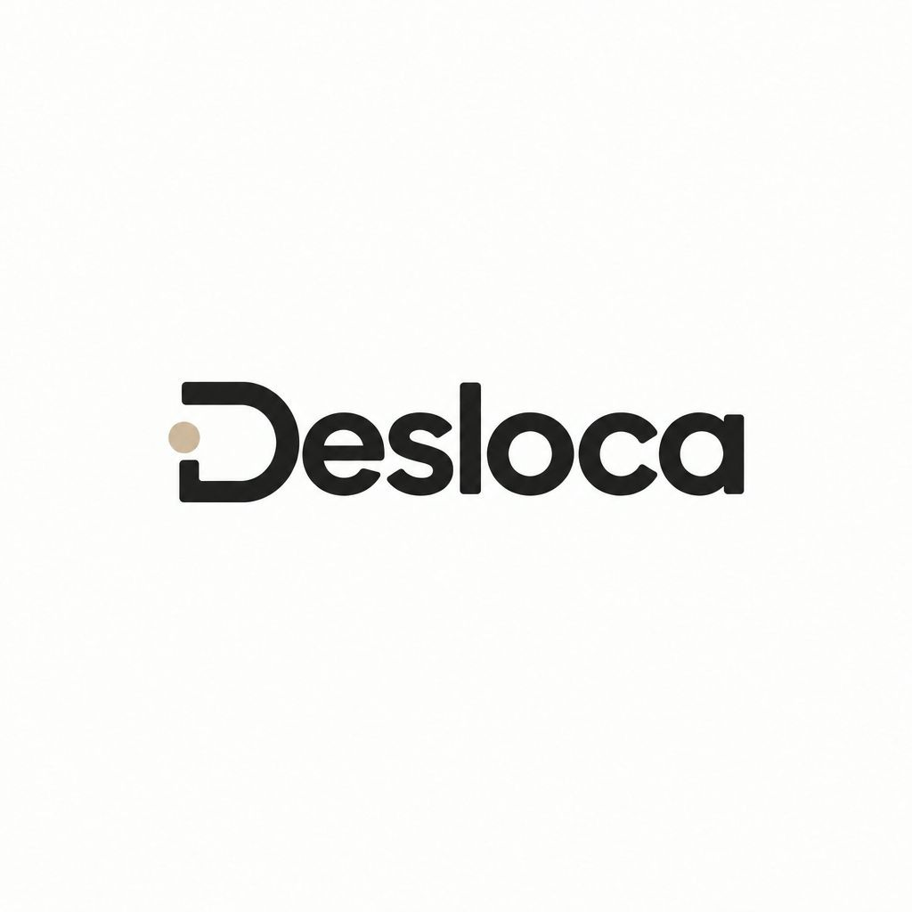

<p align="center">
  
</p>

<h1 align="center">Desloca</h1>

<p align="center">
  Plataforma para acompanhamento de percurso de condução pública
</p>

<p align="center">
  <a href="#sobre-o-projeto">Sobre</a> ·
  <a href="#funcionalidades">Funcionalidades</a> ·
  <a href="#stack-tecnológica">Stack</a> ·
  <a href="#como-rodar-o-projeto">Como rodar</a> ·
  <a href="#estrutura-do-repositório">Estrutura</a>
</p>

---

## 📖 Sobre o projeto

O **Desloca** é uma plataforma web de **mobilidade urbana** desenvolvida na
[**Fatec Araçatuba**](https://www.fatec-aracatuba.sp.gov.br/) no curso de Análise e
Desenvolvimento de Sistemas.

O projeto nasceu do problema do **tráfego de veículos motorizados**: além de gerar
congestionamentos constantes — principalmente no horário de pico —, o excesso de
carros produz grandes quantidades de **CO₂** e outros gases prejudiciais ao meio
ambiente.

### 💡 Solução

Uma aplicação web que **centraliza todas as conduções públicas** da cidade, tornando
o deslocamento mais **organizado e previsível**. Ao informar atrasos, lotação e
ocorrências em tempo real, o Desloca incentiva o uso do transporte coletivo:
menos carros nas ruas, menos congestionamento e menos emissão de gases.

---

## ✅ Funcionalidades

### Funcionalidades núcleo (protótipo)

| # | Funcionalidade | Descrição |
|---|----------------|-----------|
| 1 | **Traçar rotas** | Informando o destino, a aplicação mostra quais linhas passam por lá, os ônibus mais próximos e onde eles estão em tempo real. |
| 2 | **Previsões** | Horários, previsão de chegada, quantidade de passageiros a bordo e possível lotação. |
| 3 | **Informações e alertas** | Regras de uso, preço da passagem e alertas de acidentes, obras, clima e trânsito. |

### Telas do protótipo

- 🏠 **Início** — boas-vindas, resumo do sistema e atalhos
- 🗺️ **Mapa** — ônibus, pontos de parada e alertas em tempo real (Leaflet)
- 🚌 **Linhas** — trajeto, pontos, tarifa e previsão do próximo veículo
- ♿ **Acessibilidade** — rotas adaptadas para mobilidade reduzida
- ⚠️ **Denúncias** — formulário para reportar problemas
- 🌿 **Dicas** — conteúdo sobre sustentabilidade

### Diferenciais

- **Previsão de lotação** (vago / movimento médio / lotado) — recurso raro em apps de ônibus
- **Alertas colaborativos** de trânsito, obras e ocorrências direto no mapa
- **Reaproveitamento do road snapping** (alinhamento do trajeto às ruas via OSRM), herdado do projeto [KickIRL](https://github.com/BrunoSilva77/kickirl-backend)
- **Identidade visual própria**, baseada no logo oficial da equipe

---

## 🛠️ Stack tecnológica

| Camada | Tecnologias |
|--------|-------------|
| **Front-end** | React 18 · TypeScript · Vite · React Router · Leaflet + OpenStreetMap |
| **Back-end** | Node.js · Express · Socket.IO (WebSockets) |
| **Banco de dados** | MySQL |
| **Ferramentas** | Git · GitHub · Figma · Render.com |

> 📄 Lista completa com a finalidade de cada ferramenta: [`FERRAMENTAS.md`](FERRAMENTAS.md)
> 🗄️ Schema do banco: [`banco/desloca.sql`](banco/desloca.sql)

### Justificativa da escolha da stack

- **TypeScript** — reduz erros em tempo de execução com a checagem de tipos, essencial
  em um projeto com várias pessoas mexendo ao mesmo tempo.
- **React** — componentização reutilizável (o mesmo mapa e cabeçalho aparecem em várias
  telas), grande ecossistema e forte demanda no mercado.
- **Node.js + Express** — usa a mesma linguagem (JavaScript/TypeScript) do front-end,
  permitindo compartilhar tipos e lógica entre as camadas.
- **Socket.IO** — a posição dos ônibus precisa chegar ao mapa **instantaneamente**;
  WebSockets é o padrão para isso (reaproveitado do KickIRL).
- **MySQL** — banco relacional maduro e gratuito; as tabelas (linhas, pontos, veículos)
  se relacionam naturalmente, e é a tecnologia definida na disciplina.
- **Leaflet + OpenStreetMap** — gratuito, sem necessidade de chave de API e sem conta
  de faturamento, ideal para projeto acadêmico.

---

## ▶️ Como rodar o projeto

### Pré-requisitos

- [Node.js](https://nodejs.org/) (versão 18 ou superior)
- [Git](https://git-scm.com/)

### Passo a passo

```bash
# 1. Clone o repositório
git clone https://github.com/BrunoSilva77/desloca_web.git
cd desloca_web

# 2. Instale as dependências
npm install

# 3. Inicie o servidor de desenvolvimento
npm run dev
```

Acesse **http://localhost:5173** 🚀

### 🌐 Publicação no Render

O protótipo já está pronto para subir no [Render](https://render.com):

1. No painel do Render: **New + Web Service** e conecte o repositório
   `BrunoSilva77/desloca_web`
2. O Render detecta o [`render.yaml`](render.yaml) e usa automaticamente:
   - build: `npm ci && npm run build` (gera a pasta `dist/`)
   - start: `npm start` (sobe o servidor estático de produção)
3. O servidor `scripts/servidor-estatico.mjs` serve o `dist/` com fallback
   SPA — rotas como `/mapa` funcionam direto na URL

Para testar a produção localmente:

```bash
npm run build   # gera a pasta dist/
npm start       # http://localhost:4173 (ou PORT=xxxx npm start)
```

### Banco de dados (fase de construção)

```bash
# Crie o banco e execute o script de tabelas
mysql -u root -p < banco/desloca.sql
```

---

## 📁 Estrutura do repositório

```
desloca_web/
├── banco/
│   └── desloca.sql          # Script de criação do banco (MySQL)
├── src/
│   ├── componentes/         # Partes reutilizáveis (cabeçalho, mapa)
│   ├── dados/               # Dados simulados (mock) das linhas e alertas
│   ├── estilos/             # CSS global com as cores do logo
│   ├── paginas/             # As 6 telas do protótipo
│   ├── App.tsx              # Rotas do site
│   └── main.tsx             # Ponto de entrada
├── FERRAMENTAS.md           # Todas as linguagens e ferramentas usadas
├── banco/desloca.sql        # Schema do MySQL
└── README.md                # Este arquivo
```

---

## 👥 Equipe

| Membro | Papel no projeto |
|--------|------------------|
| **Asafe Galdino do Amaral** | Liderança · escopo · backlog · documentação |
| **Bruno Henrique Silva** | Front-end · backend · ferramentas · arquitetura técnica |
| **Guilherme de Oliveira Magalhães** | UI/UX · mockup no Figma · wireframes · integração |
| **Saory Sumida Silva** | Business Model Canvas · organização dos registros |
| **Talita Bueno Martins** | Backend · protótipo navegável |

---

## 📅 Cronograma

| Data | Etapa |
|------|-------|
| 03/11 | **Descoberta** — brainstorm, escopo, papéis, pesquisa de ferramentas |
| 04/11 | **Design e arquitetura** — backlog, protótipo navegável, treino de GitHub |
| 05/11 | **Construção** — diagrama de arquitetura, stack e justificativa |
| 06/11 | **Construção** — protótipo final, commits e README |

---

## 📄 Licença

Projeto acadêmico desenvolvido para a Fatec Araçatuba — 2026.
