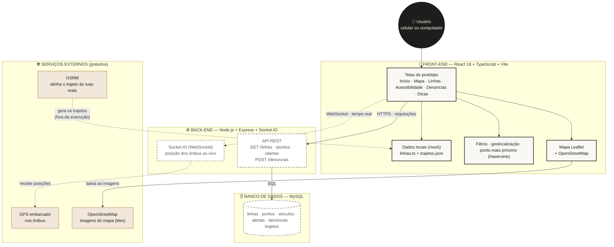
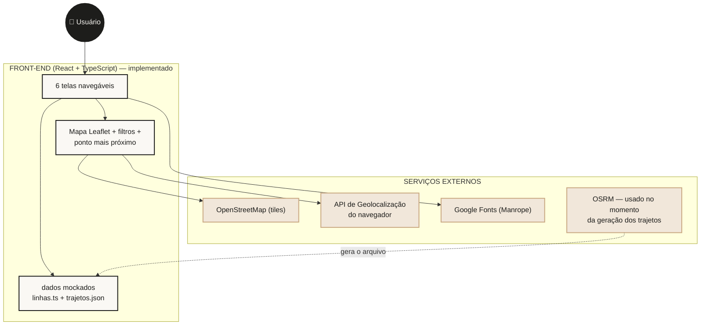

# 📐 Diagrama de Arquitetura Técnica — Desloca

> **Etapa:** 05/11 — Construção (diagrama de arquitetura, stack e justificativa)
> **Responsável:** Bruno Henrique Silva

Este documento mostra **como as partes do sistema se conectam**: de onde vem o
dado, por onde passa e onde é guardado.

---

## 1. Arquitetura final (alvo do projeto)

### 🎨 Legenda de cores

| Estilo | Significado |
|--------|-------------|
| **Borda sólida escura** | Já implementado no protótipo atual |
| **Borda tracejada** | Planejado para a fase de construção (back-end + banco) |
| **Borda bege** | Serviço externo gratuito (não faz parte do nosso código) |
| **Caixa preta** | O usuário final |

---

## 2. Fluxo do dado — passo a passo

**Quando o usuário abre o mapa:**

1. O **navegador** carrega o front-end (React + TypeScript).
2. O front-end pedi as **imagens das ruas** ao **OpenStreetMap** (gratuito).
3. Lê os **dados das linhas** do arquivo local (`linhas.ts` + `trajetos.json`).
4. Pede a **localização do usuário** à API de Geolocalização do navegador
   (com permissão) e calcula o **ponto de ônibus mais próximo**
   (distância de Haversine + tempo de caminhada a 4,5 km/h).
5. Desenha as **linhas no mapa** com Leaflet e aplica os filtros escolhidos.

**Na fase de construção (com back-end):**

6. O front-end passa a pedir as linhas à **API REST** (`GET /linhas`).
7. A API consulta o **MySQL** e devolve as respostas em JSON.
8. A posição dos ônibus chega **ao vivo** pelo **WebSocket (Socket.IO)**,
   que recebe os dados do **GPS embarcado** nos veículos.

---

## 3. Camadas e responsabilidades

| Camada | Tecnologia | Responsabilidade |
|--------|------------|------------------|
| **Apresentação** | React 18 + TypeScript + Vite | Telas, componentes, filtros, estado |
| **Mapa** | Leaflet + OpenStreetMap | Desenhar ruas, trajetos e marcadores |
| **Comunicação** | HTTPS (REST) + WebSocket | Buscar dados fixos e receber tempo real |
| **Aplicação** | Node.js + Express + Socket.IO | Regras de negócio e endpoints da API |
| **Persistência** | MySQL | Guardar linhas, pontos, veículos, alertas, denúncias |
| **Serviços externos** | OpenStreetMap · OSRM · Geolocation API | Ruas, alinhamento de trajeto e posição do usuário |

---

## 4. Diagrama do estado ATUAL (protótipo de front-end)

> Importante para a apresentação: hoje o protótipo é **100% front-end** —
> as caixas tracejadas do diagrama acima ainda não estão ligadas.

---

## 5. Justificativa da stack (resumo)

| Escolha | Por quê |
|---------|---------|
| **TypeScript** | Checagem de tipos reduz erros com várias pessoas mexendo ao mesmo tempo |
| **React** | Componentização reutilizável (mapa e cabeçalho aparecem em várias telas) e forte demanda no mercado |
| **Vite** | Servidor de desenvolvimento instantâneo e build rápido |
| **Node.js + Express** | Mesma linguagem do front-end — compartilha tipos e lógica entre camadas |
| **Socket.IO** | Posição dos ônibus precisa chegar ao mapa instantaneamente (reaproveitado do KickIRL) |
| **MySQL** | Banco relacional maduro, gratuito e definido na disciplina |
| **Leaflet + OpenStreetMap** | Gratuito, sem chave de API e sem conta de faturamento |
| **OSRM** | Alinha o trajeto às ruas reais (road snapping), técnica herdada do KickIRL |

---

## 📌 Como renderizar este diagrama

- **No GitHub:** o Mermaid é renderizado automaticamente ao abrir este arquivo.
- **No PowerPoint:** use a imagem `docs/diagrama-arquitetura.png` (gerada por
  `python testes/gerar_diagrama.py`).
- **Editável no draw.io:** copie a estrutura do fluxo da seção 1.
